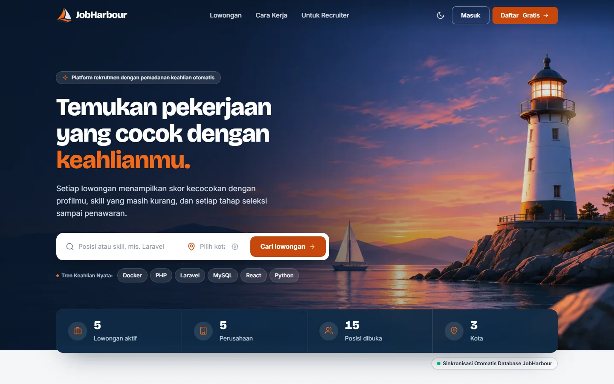
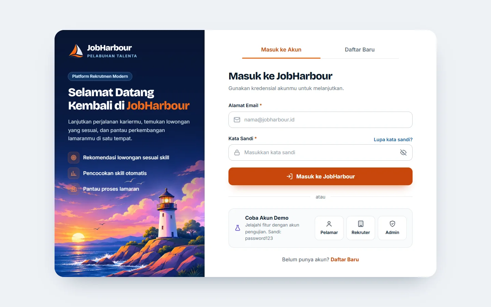
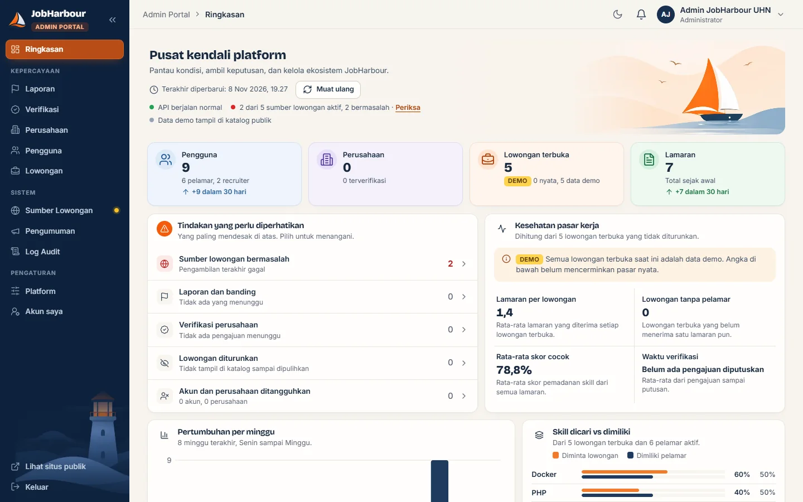

<p align="center">
  
</p>

<h1 align="center">JobHarbour</h1>

<p align="center">
  <strong>Platform Rekrutmen dengan Pencocokan Keahlian Otomatis</strong><br>
  <em>REST API Laravel, Skill-Matchmaking Engine, dan Multi-Stage Pipeline Tracker</em><br>
  <strong>"Pelabuhan Para Pekerja Sebelum Keberangkatan Menuju Dunia Karier"</strong>
</p>

<p align="center">


</p>

---

## ⚓ Tentang Proyek

**JobHarbour** adalah platform lowongan kerja dan rekrutmen yang dibangun sebagai proyek mata kuliah Pemrograman Web Service. Semua fitur disediakan lewat **REST API JSON**, yang dipakai oleh halaman web JobHarbour sendiri maupun klien lain seperti Postman.

JobHarbour menjawab dua masalah utama dalam rekrutmen:

1. **Bagi pelamar:** CV sering terasa masuk ke "lubang hitam". Di JobHarbour pelamar langsung melihat skor kecocokan keahliannya dengan setiap lowongan, skill apa yang masih kurang, dan posisi lamarannya di setiap tahap seleksi.
2. **Bagi recruiter:** menyortir ratusan berkas secara manual memakan waktu. JobHarbour mengurutkan pelamar berdasarkan skor kecocokan dan menyediakan papan pipeline seleksi bertahap.

### 🌊 Filosofi Nama

Ibarat pelabuhan (*harbour*) tempat kapal bersandar sebelum berlayar, JobHarbour adalah tempat talenta dan recruiter bertemu sebelum memulai perjalanan karier. Filosofi ini juga selaras dengan identitas **Universitas Harkat Negeri** di **Tegal**, kota bahari dengan sejarah pelabuhan yang kuat.

### 🌐 Tautan Live

| Halaman | Tautan | Keterangan |
|---|---|---|
| **Portal Publik** | [jobharbour.nour.web.id](https://jobharbour.nour.web.id) | Landing page, katalog, dan lamaran pelamar |
| **Portal Recruiter** | [/recruiter](https://jobharbour.nour.web.id/recruiter) | Lowongan, pipeline kandidat, wawancara, dan profil perusahaan |
| **Swagger UI** | [/docs](https://jobharbour.nour.web.id/docs) | Dokumentasi interaktif dari `docs/openapi.yaml` |
| **API Studio** | [/postman](https://jobharbour.nour.web.id/postman) | Konsol uji endpoint REST API di browser |
| **Pemantauan Server** | [UptimeRobot](https://dashboard.uptimerobot.com/monitors/804528529) | Health check otomatis setiap 10 menit |

### 📌 Informasi Akademik

| Komponen | Keterangan |
|---|---|
| **Mata Kuliah** | Pemrograman Web Service (5537344 / 3 SKS) |
| **Program Studi / Kampus** | Teknik Informatika - Universitas Harkat Negeri (Tegal) |
| **Dosen Pengampu** | Zaenul Arif, S.Kom., M.Kom. |
| **Kelompok** | Kelompok 4 |
| **Semester** | 7 (Ganjil) |

---

## 🖼️ Cuplikan Tampilan

<p align="center"><strong>Landing Page</strong></p>
<p align="center"></p>

<p align="center"><strong>Halaman Masuk & Daftar</strong></p>
<p align="center"></p>

<p align="center"><strong>Admin Portal - Ringkasan</strong></p>
<p align="center"></p>

---

## 🚀 Fitur Utama

- **🎯 Pencocokan keahlian otomatis.** Skor kecocokan pelamar dengan lowongan dihitung dengan *Weighted Jaccard Similarity* (bobot required = 3, important = 2, nice-to-have = 1). Logikanya ada di `app/Services/MatchmakingService.php`.

  ```text
  Skor = (jumlah bobot skill yang cocok) / (jumlah bobot semua skill lowongan) x 100%
  80-100% Excellent | 50-79% Good | 0-49% Under-qualified
  ```

- **📊 Pipeline seleksi bertahap.** Setiap perpindahan tahap dicatat lengkap dengan waktunya, dan tahap hanya bisa maju.

  ```text
  Screening -> Assessment -> Interview -> Offering
       |            |            |
    Rejected     Rejected     Rejected
  ```

- **🛡️ Tiga peran dengan JWT.** Pelamar, recruiter, dan admin punya halaman dan hak akses masing-masing. Autentikasi memakai JWT tanpa session.
- **🧑‍✈️ Portal per peran.**
  - *Pelamar:* katalog dan detail lowongan, kirim lamaran dengan CV PDF, "My Dock" untuk memantau lamaran, serta profil skill.
  - *Recruiter:* dashboard, kelola lowongan, pipeline kandidat, jadwal wawancara, analitik, profil dan verifikasi perusahaan.
  - *Admin:* ringkasan platform, verifikasi perusahaan, pengguna, moderasi lowongan, laporan, sumber lowongan, pengumuman, log audit, dan pengaturan platform.
- **🔄 Agregasi lowongan eksternal.** Perintah `php artisan jobs:sync` menarik lowongan dari sumber luar dengan timeout, retry, dan cache yang bisa diatur lewat `.env`.
- **🗺️ Atlas karier.** Peta sebaran lowongan per wilayah dengan MapLibre GL, dari endpoint `/api/geo/*`.
- **📄 Kontrak OpenAPI 3.1.** Spesifikasi lengkap di `docs/openapi.yaml`, ditampilkan lewat Swagger UI, ditambah koleksi Postman dan Thunder Client.

---

## 🛠️ Tech Stack

| Lapisan | Teknologi | Versi | Kegunaan |
|---|---|---|---|
| Backend | [Laravel](https://laravel.com) | 13.x | Framework utama, routing, Eloquent, validasi |
| Bahasa | PHP | 8.4 (minimal 8.3) | Runtime backend |
| Autentikasi | [firebase/php-jwt](https://github.com/firebase/php-jwt) | 7.x | Penerbitan dan verifikasi token JWT (`app/Services/JwtService.php`) |
| Database | MariaDB / MySQL, atau SQLite | MariaDB 11.8 di DDEV | Penyimpanan data, session, cache, dan antrean |
| Frontend | Blade + JavaScript (ES Module) | - | Halaman web yang memanggil REST API |
| Styling | [Tailwind CSS](https://tailwindcss.com) | 4.x | Utility-first CSS lewat `@tailwindcss/vite` |
| Build tool | [Vite](https://vite.dev) + `laravel-vite-plugin` | 8.x | Bundling aset dan hot reload |
| Ikon & peta | Lucide, MapLibre GL | 0.469, 6.x | Ikon antarmuka dan peta atlas karier |
| Pengujian | PHPUnit | 12.x | Feature test dan unit test |
| Kualitas kode | Laravel Pint | 1.x | Formatter PSR-12 |
| Dokumentasi API | OpenAPI 3.1, Swagger UI | 3.1.0 | Kontrak dan dokumentasi interaktif |
| Lingkungan dev | DDEV (Docker) atau PHP lokal | - | Lingkungan pengembangan yang seragam |
| CI | GitHub Actions | - | Menjalankan test pada push dan pull request ke `main` |
| Deploy | Docker (PHP 8.4 + Nginx) | - | `Dockerfile` dan blueprint `render.yaml` |

---

## 🏗️ Arsitektur Singkat

JobHarbour adalah **monolit modular**: satu aplikasi Laravel dengan satu database, tetapi kodenya dibagi per domain dengan batas tanggung jawab yang jelas.

```text
Browser (Blade + JS)  /  Postman  /  klien lain
                 |
                 v   REST API JSON  (routes/api.php, JWT)
+---------------------------------------------------------------+
|                    Aplikasi Laravel JobHarbour                |
|  Auth & Profile | Job Catalog | Application &  | Recruitment  |
|                 |             | Matchmaking    | Pipeline     |
|  + Admin, Company, Notifikasi, Agregator, Atlas Geospasial    |
+---------------------------------------------------------------+
                 |
                 v
          Satu database (MariaDB / MySQL / SQLite)
```

Semua respons API memakai amplop JSON yang sama:

```json
{
  "status": "success",
  "message": "Data berhasil dimuat",
  "data": {},
  "meta": { "timestamp": "2026-10-26T19:00:00+07:00", "version": "1.0.0" }
}
```

Validasi gagal mengembalikan `422` dengan objek `errors` per field. Detail standar ada di [`docs/API_CONTRACT_STANDARDS.md`](docs/API_CONTRACT_STANDARDS.md).

---

## 💻 Kebutuhan Sistem

Pilih salah satu cara.

**Cara A - DDEV (disarankan).** Versi PHP, Node.js, dan database otomatis seragam untuk semua anggota tim.

- [Docker Desktop](https://www.docker.com/products/docker-desktop/) atau Docker Engine
- [DDEV](https://ddev.readthedocs.io/en/stable/users/install/)
- Git

**Cara B - PHP lokal.** Misalnya Laragon, XAMPP, Herd, atau PHP dari package manager.

- PHP 8.4 (minimal 8.3) dengan ekstensi `pdo_mysql` atau `pdo_sqlite`, `mbstring`, `openssl`, `fileinfo`, `curl`, dan `zip`
- Composer 2
- Node.js 24 dan npm
- MariaDB 10.6+ / MySQL 8, atau SQLite
- Git

> Cek kesiapan lingkungan kapan saja dengan `./dev --doctor` (Linux/macOS) atau `dev.bat --doctor` (Windows).

---

## 📥 Clone dan Instalasi

### 1. Clone repository

```bash
git clone https://github.com/Nourivex/JobHarbour.git
cd JobHarbour
```

### 2a. Instalasi dengan DDEV

```bash
./dev --setup
```

Di Windows gunakan `dev.bat --setup`. Skrip ini menjalankan `ddev start`, `composer install`, menyalin `.env.example` ke `.env`, membuat `APP_KEY`, lalu `npm install` dan `npm run build`.

DDEV sudah menyiapkan database MariaDB, jadi tidak perlu mengatur koneksi secara manual.

### 2b. Instalasi tanpa DDEV

Skrip `./dev --setup` juga mendeteksi PHP lokal secara otomatis. Jika ingin manual:

```bash
composer install
cp .env.example .env
php artisan key:generate
npm install
npm run build
```

Lalu atur database di `.env`. Bawaan `.env.example` adalah SQLite. Untuk MySQL atau MariaDB, ubah menjadi:

```dotenv
DB_CONNECTION=mysql
DB_HOST=127.0.0.1
DB_PORT=3306
DB_DATABASE=jobharbour
DB_USERNAME=root
DB_PASSWORD=
```

Buat database `jobharbour` terlebih dahulu. Untuk SQLite, perintah migrasi akan menawarkan pembuatan berkas `database/database.sqlite` jika belum ada.

### 3. Migrasi dan data awal

Migrasi **tidak** dijalankan otomatis oleh skrip setup. Jalankan sendiri:

```bash
./dev migrate:fresh --seed
```

Windows: `dev.bat migrate:fresh --seed`. Tanpa skrip: `php artisan migrate:fresh --seed`.

Perintah ini membuat ulang semua tabel lalu mengisi akun demo, perusahaan, lowongan, dan lamaran contoh.

> ⚠️ `migrate:fresh` **menghapus semua data** di database yang dipakai. Jangan jalankan pada database yang berisi data penting.

### 4. (Opsional) Data untuk agregator dan atlas karier

`DatabaseSeeder` belum memanggil data master wilayah dan daftar sumber lowongan. Jika ingin mencoba `jobs:sync` atau atlas karier, jalankan:

```bash
php artisan db:seed --class=Database\\Seeders\\GeospatialMasterSeeder
php artisan db:seed --class=Database\\Seeders\\JobSourceRegistrySeeder
```

Pada DDEV, ganti `php artisan` dengan `ddev artisan`.

---

## ▶️ Menjalankan Aplikasi

**Dengan DDEV**

```bash
ddev start
ddev npm run dev     # opsional, hot reload saat mengubah CSS/JS
```

Buka `https://jobharbour.ddev.site` (atau jalankan `ddev launch`).

**Tanpa DDEV**

```bash
php artisan dev
```

Perintah ini menjalankan tiga proses sekaligus: `php artisan serve`, `php artisan queue:listen`, dan `npm run dev`. Buka `http://127.0.0.1:8000`.

Jika ingin terpisah, jalankan `php artisan serve` dan `npm run dev` di dua terminal.

**Halaman penting**

| URL | Isi |
|---|---|
| `/` | Landing page |
| `/catalog`, `/jobs/{id}` | Katalog dan detail lowongan |
| `/login` | Masuk dan daftar |
| `/my-dock`, `/profile` | Lamaran dan profil pelamar |
| `/recruiter` | Portal recruiter |
| `/admin` | Admin Portal |
| `/docs` | Swagger UI |
| `/postman` | API Studio |

---

## 👤 Akun Demo

Tersedia setelah `migrate:fresh --seed`. Semua akun memakai sandi **`password123`**. Akun ini hanya untuk pengembangan lokal.

| Peran | Email | Keterangan |
|---|---|---|
| **Admin** | `admin@jobharbour.id` | Akses Admin Portal (`/admin`) |
| **Recruiter** | `recruiter@jobharbour.id` | Pemilik PT Teknologi Maju Bahari (terverifikasi) |
| **Recruiter** | `recruiter.baru@jobharbour.id` | Pemilik CV Bawang Merah Digital (belum terverifikasi), cocok untuk mencoba alur verifikasi |
| **Pelamar** | `budi@jobharbour.id` | Budi Santoso |
| **Pelamar** | `siti@jobharbour.id` | Siti Nurhaliza |
| **Pelamar** | `andi@jobharbour.id` | Andi Pratama |
| **Pelamar** | `dewi@jobharbour.id` | Dewi Lestari |

Akun lama berakhiran `@padukerja.id` (`recruiter`, `budi`, `siti`) tetap tersedia sebagai alias.

---

## ⚙️ Konfigurasi Environment

Variabel penting di `.env`:

| Variabel | Bawaan | Keterangan |
|---|---|---|
| `APP_KEY` | dibuat oleh `key:generate` | Juga dipakai sebagai kunci tanda tangan JWT |
| `APP_URL` | `http://localhost:8000` | Sesuaikan dengan alamat aplikasi |
| `DB_CONNECTION` | `sqlite` | `mysql` / `mariadb` / `sqlite` |
| `SESSION_DRIVER`, `CACHE_STORE`, `QUEUE_CONNECTION` | `database` | Memakai tabel di database aplikasi |
| `MAIL_MAILER` | `log` | Email ditulis ke log, tidak benar-benar dikirim |
| `AGGREGATOR_TIMEOUT` | `15` | Batas waktu (detik) saat mengambil sumber lowongan |
| `AGGREGATOR_RETRY` | `2` | Jumlah percobaan ulang |
| `AGGREGATOR_RETRY_DELAY` | `500` | Jeda antar percobaan (milidetik) |
| `AGGREGATOR_CACHE_TTL` | `6` | Lama cache hasil sumber |

> Jangan pernah meng-commit `.env`, password, token, atau kunci API. Gunakan `.env.example` sebagai acuan.

---

## 🧪 Pengujian

```bash
./dev test             # atau: php artisan test
```

- Test memakai SQLite in-memory (diatur di `phpunit.xml`), jadi tidak menyentuh database pengembangan.
- Beberapa test merender halaman, sehingga aset harus sudah di-build (`npm run build`).
- Feature test ada di `tests/Feature` (API inti, Admin Portal, verifikasi perusahaan, agregator, notifikasi, laporan, keamanan session, dan lainnya). Unit test skor pencocokan ada di `tests/Unit/MatchmakingServiceTest.php`.
- GitHub Actions (`.github/workflows/tests.yml`) menjalankan test yang sama dengan PHP 8.4 dan Node.js 24 setiap ada push atau pull request ke `main`.

Format kode dengan Pint sebelum commit:

```bash
vendor/bin/pint
```

**Mencoba API secara manual:** import [`docs/PaduKerja.postman_collection.json`](docs/PaduKerja.postman_collection.json) ke Postman atau [`docs/thunder-collection_padukerja.json`](docs/thunder-collection_padukerja.json) ke Thunder Client. Panduan langkah demi langkah ada di [`docs/TESTING_GUIDE.md`](docs/TESTING_GUIDE.md).

---

## 📡 Dokumentasi API

Aplikasi menyediakan sekitar 75 endpoint di bawah prefix `/api`. Daftar lengkap bisa dilihat dengan `php artisan route:list --path=api` atau di Swagger UI (`/docs`).

| Kelompok | Prefix | Contoh |
|---|---|---|
| Auth & Profile | `/api/auth`, `/api/profile` | `POST /api/auth/login`, `GET /api/auth/me`, `PUT /api/profile/skills` |
| Job Catalog | `/api/jobs`, `/api/company` | `GET /api/jobs`, `POST /api/jobs`, `GET /api/jobs/{id}` |
| Application & Matchmaking | `/api/applications` | `POST /api/applications` (dengan CV PDF), `GET /api/applications/{id}/cv` |
| Recruitment Pipeline | `/api/pipelines` | `GET /api/pipelines/{id}`, `PATCH /api/pipelines/{id}/status` |
| Admin | `/api/admin` | Ringkasan, verifikasi, pengguna, lowongan, laporan, pengaturan |
| Pendukung | `/api/notifications`, `/api/geo`, `/api/aggregator`, `/api/health` | Notifikasi, atlas karier, sinkron sumber, health check |

**Kode status HTTP**

| Kode | Arti | Kapan dipakai |
|:---:|---|---|
| `200` | OK | Permintaan berhasil |
| `201` | Created | Data baru berhasil dibuat |
| `400` | Bad Request | Format permintaan atau parameter salah |
| `401` | Unauthorized | Belum login atau token kedaluwarsa |
| `403` | Forbidden | Login, tetapi peran tidak berhak |
| `404` | Not Found | Data atau URL tidak ditemukan |
| `409` | Conflict | Bentrok data, misalnya email sudah terdaftar |
| `422` | Unprocessable Entity | Validasi input gagal |
| `500` | Internal Server Error | Kendala tak terduga di server |

**Dokumen terkait**

- [`docs/openapi.yaml`](docs/openapi.yaml) - Kontrak OpenAPI 3.1.0
- [`docs/API_CONTRACT_STANDARDS.md`](docs/API_CONTRACT_STANDARDS.md) - Amplop JSON, header, dan penanganan error
- [`docs/api-design.md`](docs/api-design.md) - API Design Document v1
- [`docs/ARCHITECTURE.md`](docs/ARCHITECTURE.md) - Rancangan arsitektur dan formula matchmaking
- [`docs/SPRINT_PLAN.md`](docs/SPRINT_PLAN.md) - Milestone dan backlog
- [`docs/materi/`](docs/materi/minggu-2/README.md) - Berkas tugas mingguan (Minggu 2 sampai 5)

---

## 📂 Struktur Direktori

```text
JobHarbour/
├── app/
│   ├── Console/Commands/       # Perintah artisan, misalnya jobs:sync
│   ├── Http/Controllers/Api/   # Controller REST API per domain
│   ├── Models/                 # Model Eloquent (User, JobVacancy, Application, dll)
│   └── Services/               # MatchmakingService, JwtService, Aggregator
├── database/
│   ├── migrations/             # Skema tabel
│   └── seeders/                # Data demo, master wilayah, sumber lowongan
├── docker/                     # Konfigurasi Nginx dan entrypoint container
├── docs/                       # Dokumentasi proyek, OpenAPI, koleksi Postman, screenshot
├── public/                     # Document root dan aset gambar
├── resources/
│   ├── css/                    # Tailwind CSS (app.css, workspace.css)
│   ├── js/                     # Klien API dan komponen halaman
│   └── views/                  # Blade: pages, recruiter, admin, layouts
├── routes/
│   ├── api.php                 # Rute REST API
│   └── web.php                 # Rute halaman web
├── tests/
│   ├── Feature/                # Feature test endpoint
│   └── Unit/                   # Unit test (skor pencocokan)
├── .ddev/                      # Konfigurasi DDEV
├── .github/workflows/          # GitHub Actions
├── Dockerfile, render.yaml     # Deploy produksi
├── dev, dev.bat                # Skrip pembantu (Linux/macOS dan Windows)
└── README.md
```

Skrip `./dev` meneruskan perintah ke Artisan, jadi `./dev route:list`, `./dev tinker`, atau `./dev make:controller Api/ContohController --api` bisa dipakai langsung.

---

## 🚢 Deployment

Aplikasi bisa di-deploy sebagai container Docker (PHP 8.4 + Nginx) memakai `Dockerfile`, dengan blueprint Render di `render.yaml`. Panduan lengkap ada di [`docs/DEPLOYMENT_RENDER.md`](docs/DEPLOYMENT_RENDER.md).

---

## 👥 Tim Pengembang

| No | Domain | Penanggung Jawab | NIM | Controller Utama | Dokumentasi |
|:---:|---|---|:---:|---|:---:|
| 1 | **Auth & Profile** | **Nabe'ela Ayu Ning Tyas Zahra** | `23215052` | `AuthController`, `ProfileSkillController` | [Modul Auth](docs/materi/minggu-2/auth-profile/README.md) |
| 2 | **Job Catalog** | **M. Fahren Andrean Rangkuti** | `23215030` | `JobVacancyController`, `CompanyController` | [Modul Job Catalog](docs/materi/minggu-2/job-catalog/README.md) |
| 3 | **Application & Matchmaking** | **Muhammad Yasir Ilham Nabil** | `23215040` | `ApplicationController`, `MatchmakingService` | [Modul Application](docs/materi/minggu-2/application-matchmaking/README.md) |
| 4 | **Recruitment Pipeline** | **Muhammad Affif** | `24225046` | `PipelineController` | [Modul Pipeline](docs/materi/minggu-2/recruitment-pipeline/README.md) |

---

## 🤝 Panduan Kontribusi

1. **Buat branch dari `main`**, misalnya `nama/fitur-singkat`. Jangan push langsung ke `main`.
2. **Ikuti kontrak API.** Setiap respons memakai amplop `status`, `message`, `data`, `meta`. Validasi lewat Form Request, format respons lewat API Resource.
3. **Tulis test** untuk setiap endpoint baru atau yang diubah, lalu pastikan `php artisan test` lulus.
4. **Rapikan kode** dengan `vendor/bin/pint` (PSR-12).
5. **Perbarui dokumentasi** di `docs/` dan `docs/openapi.yaml` jika endpoint berubah.
6. **Buka pull request** ke `main` dan tunggu review serta CI hijau sebelum merge.

---

## 📄 Lisensi dan Atribusi

Proyek **JobHarbour** dirilis di bawah lisensi terbuka berbasis atribusi. Dokumen lisensi resmi dan lengkap dapat dilihat pada berkas [LICENSE.md](LICENSE.md).

Hak Cipta © 2026 **Kelompok 4 - Pemrograman Web Service, Universitas Harkat Negeri Tegal**.

### Ketentuan Lisensi:
1. **Kebebasan Penggunaan:** Siapa pun diizinkan secara bebas untuk melihat, menggunakan, melakukan *fork*, memodifikasi, menggabungkan, mempublikasikan pembaruan, dan mengembangkan karya turunan (*derivative work*) dari proyek ini, baik untuk tujuan akademik, riset, maupun pengembangan portofolio profesional.
2. **Kewajiban Atribusi (Credit Wajib):** Setiap salinan, repositori hasil *fork*, atau karya turunan yang dikembangkan dari basis kode ini **wajib mempertahankan pemberitahuan hak cipta asli dan mencantumkan tautan ke repositori sumber ini** ([https://github.com/Nourivex/JobHarbour](https://github.com/Nourivex/JobHarbour)) serta mencantumkan nama anggota Kelompok 4 sebagai pencipta fondasi awal.
3. **Pemberitahuan Akademik:** Kode sumber ini awalnya dibangun sebagai pemenuhan proyek mata kuliah Pemrograman Web Service (5537344 / 3 SKS), Fakultas Sains dan Teknologi, Universitas Harkat Negeri Tegal, di bawah bimbingan dosen pengampu Zaenul Arif, S.Kom., M.Kom.
4. **Tanpa Jaminan:** Perangkat lunak ini disediakan apa adanya (*as-is*), tanpa jaminan apa pun terkait keandalan atau kesesuaian untuk tujuan tertentu.

**Pencipta Fondasi Awal (Kelompok 4):**
- Nabe'ela Ayu Ning Tyas Zahra (NIM: 23215052)
- M. Fahren Andrean Rangkuti (NIM: 23215030)
- Muhammad Yasir Ilham Nabil (NIM: 23215040)
- Muhammad Affif (NIM: 24225046)

---

<p align="center">
  Dibuat dengan semangat belajar oleh <strong>Kelompok 4</strong><br>
  Mata Kuliah Pemrograman Web Service - <strong>Universitas Harkat Negeri (Tegal)</strong>
</p>
