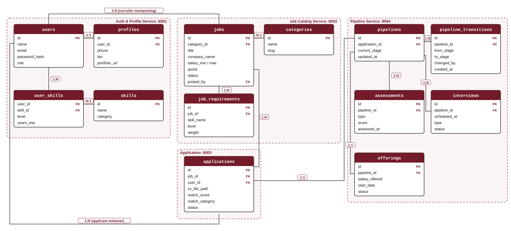

# API Design Document v1: PaduKerja

> **Platform Rekrutmen Terintegrasi Berbasis Microservice**  
> *Automated Skill-Matchmaking Engine & Multi-Stage Pipeline Tracker*  
> Mata Kuliah: Pemrograman Web Service (5537344 / 3 SKS) - Universitas Harkat Negeri  
> Dosen Pengampu: Zaenul Arif, S.Kom., M.Kom.  
> Bagian Pertama Milestone M2 - API Blueprint (Minggu ke-4)  

---

## A. Identitas Proyek & Konvensi

### 1. Informasi Tim Pengembang (Kelompok 4)

| No | Nama Mahasiswa | NIM | Tanggung Jawab Microservice |
|:---:|---|:---:|---|
| 1 | **M. Fahren Andrean Rangkuti** | `23215030` | Job Catalog Service (`db_jobs` / `:8002`) |
| 2 | **Muhammad Yasir Ilham Nabil** | `23215040` | Application & Matchmaking Service (`db_applications` / `:8003`) |
| 3 | **Nabe'ela Ayu Ning Tyas Zahra** | `23215052` | Auth & Profile Service (`db_auth` / `:8001`) |
| 4 | **Muhammad Affif** | `24225046` | Recruitment Pipeline Service (`db_pipeline` / `:8004`) |

### 2. Lingkungan, Base URL & Versi

| Komponen | Base URL / Host | Keterangan |
|---|---|---|
| **API Gateway (Unified)** | `http://localhost:8000/api/v1` | Reverse proxy rute lintas layanan (titik masuk client) |
| **Auth & Profile Service** | `http://localhost:8001/api/v1` | Layanan autentikasi & profil pengguna |
| **Job Catalog Service** | `http://localhost:8002/api/v1` | Layanan manajemen lowongan kerja |
| **Application Service** | `http://localhost:8003/api/v1` | Layanan berkas lamaran & matchmaking |
| **Pipeline Service** | `http://localhost:8004/api/v1` | Layanan linimasa tahapan seleksi |

- **Versi API:** `v1`, dipasang sebagai prefix URI `/api/v1` pada seluruh endpoint. Perubahan yang tidak kompatibel akan dirilis sebagai `/api/v2`.
- Seluruh URI pada dokumen ini ditulis relatif terhadap base URL Gateway.

### 3. Konvensi Penamaan (Naming Conventions)
- **Bahasa penamaan:** Bahasa **Inggris** untuk nama resource, atribut, dan parameter. Pesan (`message`) untuk pengguna ditulis dalam Bahasa Indonesia.
- **URI Path:** Kata benda jamak huruf kecil (*lowercase plural nouns*), kebab-case untuk multi-kata, tanpa kata kerja, nesting maksimal 2 tingkat. Contoh: `/api/v1/jobs`, `/api/v1/jobs/{id}/applications`.
- **JSON Keys & Attributes:** *snake_case*, contoh: `employment_type`, `match_score`, `created_at`.
- **Query Parameters:** *snake_case*, contoh: `?per_page=15&salary_min=8000000`.
- **Format Waktu:** ISO 8601 dengan zona waktu, contoh: `2026-10-16T17:45:00+07:00`.
- **Format Pertukaran Data:** JSON (RFC 8259) dengan header wajib `Content-Type: application/json` dan `Accept: application/json`.
- **Otentikasi:** JSON Web Token (JWT) melalui header `Authorization: Bearer <token>`.

---

## B. Pemodelan Resource & Relasi

Sistem PaduKerja dimodelkan ke dalam 14 resource (13 resource data + 1 singleton `me`) yang tersebar di 4 service.

### 1. Spesifikasi Atribut Resource

| No | Resource | Service | Atribut Utama & Tipe Data | Jenis |
|:---:|---|---|---|---|
| 1 | **`users`** | Auth | id (bigint), name (string), email (string, unik), password_hash (string, tidak diekspos), role (enum: applicant, recruiter, admin), created_at (datetime) | Collection |
| 2 | **`me`** | Auth | Gabungan data users dan profiles milik pengguna yang login | Singleton |
| 3 | **`profiles`** | Auth | id (bigint), user_id (bigint), phone (string), bio (text), location (string), portfolio_url (string) | Bagian dari /me |
| 4 | **`skills`** | Auth | id (bigint), name (string, unik), category (string) | Collection |
| 5 | **`user_skills`** | Auth | user_id (bigint), skill_id (bigint), level (enum: beginner, intermediate, advanced), years_exp (integer) | Sub-resource |
| 6 | **`categories`** | Job Catalog | id (bigint), name (string), slug (string, unik) | Collection |
| 7 | **`jobs`** | Job Catalog | id (bigint), category_id (bigint), title (string), company_name (string), description (text), location (string), employment_type (enum), salary_min (integer), salary_max (integer), quota (integer), status (enum: open, closed), posted_by (bigint) | Collection |
| 8 | **`job_requirements`** | Job Catalog | id (bigint), job_id (bigint), skill_name (string), level (enum: required, important, nice_to_have), weight (integer: 3/2/1) | Sub-resource |
| 9 | **`applications`** | Application | id (bigint), job_id (bigint), user_id (bigint), cv_file_path (string), cover_letter (text), match_score (decimal 5,2), match_category (enum), status (enum: submitted, in_review, withdrawn), applied_at (datetime) | Collection, CV sebagai singleton |
| 10 | **`pipelines`** | Pipeline | id (bigint), application_id (bigint), current_stage (enum: screening, assessment, interview, offering, rejected), created_at, updated_at (datetime) | Collection |
| 11 | **`pipeline_transitions`** | Pipeline | id (bigint), pipeline_id (bigint), from_stage (enum), to_stage (enum), notes (text), changed_by (bigint), created_at (datetime) | Sub-resource |
| 12 | **`assessments`** | Pipeline | id (bigint), pipeline_id (bigint), type (enum: technical, psychological), score (decimal 5,2), notes (text), assessed_at (datetime) | Sub-resource |
| 13 | **`interviews`** | Pipeline | id (bigint), pipeline_id (bigint), scheduled_at (datetime), type (enum: online, offline), meeting_url (string), interviewer (string), status (enum: scheduled, completed, cancelled) | Sub-resource |
| 14 | **`offerings`** | Pipeline | id (bigint), pipeline_id (bigint), salary_offered (integer), start_date (date), expires_at (datetime), status (enum: sent, accepted, declined) | Sub-resource |

### 2. Relasi

| Relasi | Kardinalitas | Keterangan |
|---|:---:|---|
| users - profiles | 1 : 1 | Satu akun memiliki satu profil. |
| users - skills (melalui user_skills) | N : M | Pengguna memiliki banyak keahlian. |
| categories - jobs | 1 : N | Satu kategori menaungi banyak lowongan. |
| users (recruiter) - jobs | 1 : N | Recruiter menerbitkan banyak lowongan. |
| jobs - job_requirements | 1 : N | Lowongan memiliki banyak syarat keahlian. |
| jobs - applications | 1 : N | Lowongan menerima banyak lamaran. |
| users (applicant) - applications | 1 : N | Pelamar mengajukan banyak lamaran (maks. 1 per lowongan). |
| applications - pipelines | 1 : 1 | Pipeline dibuat otomatis saat lamaran dibuat. |
| pipelines - pipeline_transitions | 1 : N | Setiap perpindahan tahap dicatat beserta waktunya. |
| pipelines - assessments | 1 : N | Kandidat dapat menjalani beberapa assessment. |
| pipelines - interviews | 1 : N | Kandidat dapat dijadwalkan beberapa wawancara. |
| pipelines - offerings | 1 : 1 | Satu penawaran kerja per kandidat. |

Relasi lintas service (misal `applications.job_id` ke `jobs.id`) hanya berupa referensi ID. Tidak ada foreign key lintas database; validasi dilakukan melalui REST API antar-service.

### 3. Diagram Relasi Entitas (ERD Ringkas)



Versi teks:

```text
[Auth]         users 1---1 profiles | users N---M skills (user_skills)
[Job Catalog]  categories 1---N jobs 1---N job_requirements | users 1---N jobs (recruiter)
[Application]  jobs 1---N applications N---1 users (applicant)
[Pipeline]     applications 1---1 pipelines
               pipelines 1---N pipeline_transitions | 1---N assessments | 1---N interviews | 1---1 offerings
```

---

## C. Matriks Endpoint (40 Endpoint)

Keterangan status: setiap `POST` yang membuat resource mengembalikan `201 Created` beserta header `Location`; setiap `DELETE` mengembalikan `204 No Content` tanpa body. Endpoint dikelompokkan per service sesuai pembagian tanggung jawab anggota dan mencakup seluruh rancangan worksheet Minggu 3.

| No | Method | URI Endpoint | Fungsi Bisnis | Aktor | Status Sukses | Status Gagal |
|:---:|:---:|---|---|:---:|:---:|---|
| | | **Auth & Profile Service (Nabe'ela)** | | | | |
| 1 | `POST` | `/api/v1/auth/register` | Mendaftarkan akun baru | Public | `201` | `409`, `422` |
| 2 | `POST` | `/api/v1/auth/login` | Verifikasi kredensial dan menerbitkan JWT | Public | `200` | `401`, `422` |
| 3 | `POST` | `/api/v1/auth/logout` | Mencabut token aktif | Semua (login) | `204` | `401` |
| 4 | `GET` | `/api/v1/me` | Profil pengguna yang login | Semua (login) | `200` | `401` |
| 5 | `PATCH` | `/api/v1/me` | Memperbarui sebagian data profil | Semua (login) | `200` | `401`, `422` |
| 6 | `GET` | `/api/v1/me/skills` | Daftar keahlian milik pengguna | Applicant | `200` | `401`, `403` |
| 7 | `PUT` | `/api/v1/me/skills` | Mengganti seluruh daftar keahlian | Applicant | `200` | `401`, `403`, `422` |
| 8 | `POST` | `/api/v1/me/skills` | Menambah satu keahlian | Applicant | `201` | `401`, `403`, `409`, `422` |
| 9 | `DELETE` | `/api/v1/me/skills/{skill_id}` | Menghapus satu keahlian | Applicant | `204` | `401`, `403`, `404` |
| 10 | `GET` | `/api/v1/users/{id}` | Profil publik seorang pengguna | Recruiter, Admin | `200` | `401`, `403`, `404` |
| 11 | `GET` | `/api/v1/users/{id}/skills` | Keahlian seorang pelamar (untuk recruiter dan matchmaking) | Recruiter, Service internal | `200` | `401`, `403`, `404` |
| 12 | `GET` | `/api/v1/skills` | Katalog keahlian | Public | `200` | `422` |
| | | **Job Catalog Service (Fahren)** | | | | |
| 13 | `GET` | `/api/v1/categories` | Daftar kategori bidang pekerjaan | Public | `200` | `422` |
| 14 | `GET` | `/api/v1/jobs` | Daftar lowongan dengan filter, search, sort, pagination | Public | `200` | `422` |
| 15 | `GET` | `/api/v1/jobs/{id}` | Detail lowongan beserta requirements | Public | `200` | `404` |
| 16 | `POST` | `/api/v1/jobs` | Menerbitkan lowongan baru | Recruiter | `201` | `401`, `403`, `422` |
| 17 | `PUT` | `/api/v1/jobs/{id}` | Mengganti seluruh data lowongan | Recruiter (pemilik) | `200` | `401`, `403`, `404`, `422` |
| 18 | `PATCH` | `/api/v1/jobs/{id}` | Memperbarui sebagian field (misal menutup lowongan) | Recruiter (pemilik) | `200` | `401`, `403`, `404`, `422` |
| 19 | `DELETE` | `/api/v1/jobs/{id}` | Menghapus lowongan | Recruiter (pemilik), Admin | `204` | `401`, `403`, `404`, `409` |
| 20 | `GET` | `/api/v1/jobs/{id}/requirements` | Daftar syarat keahlian lowongan | Public, Service internal | `200` | `404` |
| 21 | `POST` | `/api/v1/jobs/{id}/requirements` | Menambah syarat keahlian beserta bobotnya | Recruiter (pemilik) | `201` | `401`, `403`, `404`, `409`, `422` |
| 22 | `DELETE` | `/api/v1/jobs/{id}/requirements/{requirement_id}` | Menghapus satu syarat keahlian | Recruiter (pemilik) | `204` | `401`, `403`, `404` |
| | | **Application & Matchmaking Service (Yasir)** | | | | |
| 23 | `POST` | `/api/v1/applications` | Mengirim lamaran dan menghitung skor matchmaking | Applicant | `201` | `401`, `403`, `404`, `409`, `422` |
| 24 | `GET` | `/api/v1/applications` | Riwayat lamaran milik pelamar | Applicant | `200` | `401`, `422` |
| 25 | `GET` | `/api/v1/applications/{id}` | Detail lamaran beserta rincian skor kecocokan | Applicant (pemilik), Recruiter | `200` | `401`, `403`, `404` |
| 26 | `PATCH` | `/api/v1/applications/{id}` | Mengubah status lamaran (misal submitted ke in_review) | Recruiter (pemilik lowongan) | `200` | `401`, `403`, `404`, `422` |
| 27 | `DELETE` | `/api/v1/applications/{id}` | Menarik lamaran (soft delete) | Applicant (pemilik) | `204` | `401`, `403`, `404`, `409` |
| 28 | `PUT` | `/api/v1/applications/{id}/cv` | Mengunggah atau mengganti berkas CV | Applicant (pemilik) | `200` | `401`, `403`, `404`, `422` |
| 29 | `GET` | `/api/v1/applications/{id}/cv` | Mengunduh berkas CV | Applicant (pemilik), Recruiter | `200` | `401`, `403`, `404` |
| 30 | `GET` | `/api/v1/jobs/{id}/applications` | Pelamar satu lowongan, default urut skor tertinggi | Recruiter (pemilik) | `200` | `401`, `403`, `404`, `422` |
| | | **Recruitment Pipeline Service (Affif)** | | | | |
| 31 | `POST` | `/api/v1/pipelines` | Membuat pipeline saat lamaran dibuat | Service internal | `201` | `401`, `409`, `422` |
| 32 | `GET` | `/api/v1/pipelines` | Daftar kandidat per tahap (tampilan board) | Recruiter | `200` | `401`, `403`, `422` |
| 33 | `GET` | `/api/v1/pipelines/{id}` | Tahap seleksi kandidat saat ini | Applicant (pemilik), Recruiter | `200` | `401`, `403`, `404` |
| 34 | `POST` | `/api/v1/pipelines/{id}/transitions` | Memindahkan kandidat ke tahap berikutnya atau rejected | Recruiter | `201` | `401`, `403`, `404`, `409`, `422` |
| 35 | `GET` | `/api/v1/pipelines/{id}/transitions` | Riwayat perpindahan tahap | Applicant (pemilik), Recruiter | `200` | `401`, `403`, `404` |
| 36 | `POST` | `/api/v1/pipelines/{id}/assessments` | Mencatat hasil assessment kandidat | Recruiter | `201` | `401`, `403`, `404`, `409`, `422` |
| 37 | `POST` | `/api/v1/pipelines/{id}/interviews` | Menjadwalkan wawancara | Recruiter | `201` | `401`, `403`, `404`, `409`, `422` |
| 38 | `GET` | `/api/v1/pipelines/{id}/interviews` | Daftar jadwal wawancara kandidat | Applicant (pemilik), Recruiter | `200` | `401`, `403`, `404` |
| 39 | `PATCH` | `/api/v1/interviews/{id}` | Mengubah jadwal atau status wawancara | Recruiter | `200` | `401`, `403`, `404`, `422` |
| 40 | `POST` | `/api/v1/pipelines/{id}/offerings` | Mengirim penawaran kerja kepada kandidat | Recruiter | `201` | `401`, `403`, `404`, `409`, `422` |

Catatan otorisasi: `GET /api/v1/applications` secara implisit hanya mengembalikan lamaran milik pelamar yang login, dan `GET /api/v1/pipelines` hanya kandidat dari lowongan milik recruiter yang login. Aturan ini ditegakkan oleh server, bukan oleh parameter dari client. Endpoint bertanda *Service internal* dipanggil antar-service dengan service token.

---

## D. Desain Query: Filtering, Searching, Sorting, & Pagination

Aturan umum untuk semua endpoint collection:
- **Model pagination:** offset/page-based (`page`, `per_page`), sesuai `paginate()` Laravel.
- **Whitelist:** hanya parameter dan field yang tercantum di tabel yang diterima. Parameter tidak dikenal diabaikan; nilai tidak valid (misal `sort=password`, `per_page=500`, `page=0`) ditolak dengan `422`.
- **Urutan default deterministik:** selalu ditambah `id` sebagai pemutus seri agar halaman tidak "melompat".
- **Metadata:** dikirim di body melalui `meta` dan `links` (lihat bagian E).

### 1. `GET /api/v1/jobs`

| Parameter | Jenis | Contoh | Aturan, Default & Batas |
|---|---|---|---|
| `q` | Search | `?q=backend` | Dicari pada title dan description; maks. 80 karakter |
| `category_id` | Filter relasi | `?category_id=3` | ID kategori yang valid |
| `location` | Filter | `?location=jakarta` | Pencocokan tepat (tidak membedakan huruf besar/kecil) |
| `employment_type` | Filter | `?employment_type=full-time,contract` | full-time, part-time, contract, internship; boleh lebih dari satu |
| `salary_min` | Filter rentang | `?salary_min=8000000` | Angka >= 0; lowongan dengan salary_max >= nilai ini |
| `status` | Filter | `?status=open` | open, closed. Default: open |
| `sort` | Sort | `?sort=-salary_min` | Whitelist: created_at, salary_min, salary_max, title. Default: -created_at,id |
| `page / per_page` | Pagination | `?page=2&per_page=20` | Default 1 / 15, maksimum per_page 50 |

### 2. `GET /api/v1/jobs/{id}/applications`

| Parameter | Jenis | Contoh | Aturan, Default & Batas |
|---|---|---|---|
| `match_category` | Filter | `?match_category=excellent,good` | excellent (80-100), good (50-79), under_qualified (0-49) |
| `status` | Filter | `?status=submitted` | submitted, in_review, withdrawn. Default: semua kecuali withdrawn |
| `score_min` | Filter rentang | `?score_min=60` | Angka 0-100 |
| `sort` | Sort | `?sort=-match_score` | Whitelist: match_score, applied_at. Default: -match_score,applied_at,id |
| `page / per_page` | Pagination | `?page=1&per_page=10` | Default 1 / 10, maksimum per_page 30 |

### 3. `GET /api/v1/pipelines`

| Parameter | Jenis | Contoh | Aturan, Default & Batas |
|---|---|---|---|
| `stage` | Filter | `?stage=interview` | screening, assessment, interview, offering, rejected; menggantikan tampilan /board |
| `job_id` | Filter relasi | `?job_id=12` | Hanya lowongan milik recruiter yang login |
| `sort` | Sort | `?sort=-updated_at` | Whitelist: updated_at, created_at. Default: -updated_at,id |
| `page / per_page` | Pagination | `?page=1&per_page=20` | Default 1 / 20, maksimum per_page 50 |

### 4. `GET /api/v1/applications`

| Parameter | Jenis | Contoh | Aturan, Default & Batas |
|---|---|---|---|
| `status` | Filter | `?status=submitted,in_review` | submitted, in_review, withdrawn |
| `sort` | Sort | `?sort=-applied_at` | Whitelist: applied_at, match_score. Default: -applied_at,id |
| `page / per_page` | Pagination | `?page=1&per_page=15` | Default 1 / 15, maksimum per_page 50 |

### 5. Collection Lainnya

Collection berikut berukuran kecil atau berupa riwayat, sehingga cukup memakai aturan pagination dan sort yang sama dengan nilai default berikut:

| Endpoint | Filter / Search | Sort (whitelist & default) | Pagination (default / maks) |
|---|---|---|---|
| `GET /api/v1/me/skills` | - | Whitelist: name, years_exp. Default: name,id | 15 / 50 |
| `GET /api/v1/users/{id}/skills` | - | Whitelist: name, years_exp. Default: name,id | 15 / 50 |
| `GET /api/v1/skills` | `q (name)`, `category` | Whitelist: name. Default: name,id | 50 / 100 |
| `GET /api/v1/categories` | `q (name)` | Whitelist: name. Default: name,id | 50 / 100 |
| `GET /api/v1/jobs/{id}/requirements` | `level` | Whitelist: weight, skill_name. Default: -weight,id | 15 / 50 |
| `GET /api/v1/pipelines/{id}/transitions` | - | Whitelist: created_at. Default: created_at,id (kronologis) | 15 / 50 |
| `GET /api/v1/pipelines/{id}/interviews` | `status` | Whitelist: scheduled_at. Default: scheduled_at,id | 15 / 50 |

Contoh gabungan:
```
GET /api/v1/jobs?q=laravel&category_id=3&location=jakarta&employment_type=full-time&salary_min=8000000&sort=-salary_min&page=1&per_page=10
GET /api/v1/pipelines?stage=interview&job_id=12&per_page=20
```

---

## E. Desain Representasi Data (JSON Envelope)

Seluruh response sukses memakai envelope `status`, `message`, `data`, `meta`; response collection menambahkan `links`. Representasi hanya memuat field yang dibutuhkan client (misal `password_hash` tidak pernah dikirim).

### 1. Item: `GET /api/v1/jobs/12` (`200 OK`)

```json
{
  "status": "success",
  "message": "Detail lowongan berhasil diambil",
  "data": {
    "id": 12,
    "title": "Backend Developer",
    "company_name": "PT Teknologi Maju",
    "description": "Membangun REST API microservices dengan Laravel dan MariaDB.",
    "location": "Jakarta",
    "employment_type": "full-time",
    "salary_range": { "min": 9000000, "max": 15000000, "currency": "IDR" },
    "quota": 3,
    "status": "open",
    "requirements": [
      { "id": 1, "skill_name": "PHP", "level": "required", "weight": 3 },
      { "id": 2, "skill_name": "Laravel", "level": "required", "weight": 3 },
      { "id": 3, "skill_name": "MySQL", "level": "important", "weight": 2 }
    ],
    "created_at": "2026-10-11T09:00:00+07:00",
    "updated_at": "2026-10-11T09:00:00+07:00"
  },
  "meta": { "timestamp": "2026-10-16T17:45:00+07:00", "version": "v1" }
}
```

### 2. Collection: `GET /api/v1/jobs?page=2&per_page=2` (`200 OK`)

```json
{
  "status": "success",
  "message": "Daftar lowongan berhasil diambil",
  "data": [
    { "id": 13, "title": "Frontend Engineer", "company_name": "PT Solusi Digital", "location": "Bandung", "salary_min": 8500000, "status": "open" },
    { "id": 14, "title": "QA Engineer", "company_name": "PT Kode Nusantara", "location": "Tegal", "salary_min": 6000000, "status": "open" }
  ],
  "links": {
    "first": "http://localhost:8000/api/v1/jobs?page=1&per_page=2",
    "last": "http://localhost:8000/api/v1/jobs?page=9&per_page=2",
    "prev": "http://localhost:8000/api/v1/jobs?page=1&per_page=2",
    "next": "http://localhost:8000/api/v1/jobs?page=3&per_page=2"
  },
  "meta": {
    "timestamp": "2026-10-16T17:45:00+07:00",
    "version": "v1",
    "current_page": 2,
    "per_page": 2,
    "from": 3,
    "to": 4,
    "last_page": 9,
    "total": 17
  }
}
```

### 3. Create: `POST /api/v1/applications` (`201 Created`)

Request:
```json
{ "job_id": 12, "cover_letter": "Saya tertarik dengan posisi ini...", "cv_file_path": "cv/101-backend.pdf" }
```

Response header: `Location: /api/v1/applications/45`

```json
{
  "status": "success",
  "message": "Lamaran berhasil dikirim dan skor kecocokan telah dihitung",
  "data": {
    "id": 45,
    "job_id": 12,
    "user_id": 101,
    "match_score": 80.00,
    "match_category": "excellent",
    "matched_skills": ["PHP", "Laravel", "MySQL"],
    "missing_skills": ["Redis"],
    "status": "submitted",
    "pipeline_id": 30,
    "applied_at": "2026-10-16T17:45:05+07:00"
  },
  "meta": { "timestamp": "2026-10-16T17:45:05+07:00", "version": "v1" }
}
```

### 4. Collection: `GET /api/v1/jobs/12/applications?match_category=excellent&per_page=10` (`200 OK`)

```json
{
  "status": "success",
  "message": "Daftar pelamar berhasil diambil",
  "data": [
    { "id": 45, "user_id": 101, "applicant_name": "Rina Saputri", "match_score": 80.00, "match_category": "excellent", "status": "submitted", "applied_at": "2026-10-16T17:45:05+07:00" },
    { "id": 51, "user_id": 117, "applicant_name": "Dimas Pratama", "match_score": 88.89, "match_category": "excellent", "status": "in_review", "applied_at": "2026-10-17T08:10:00+07:00" }
  ],
  "links": {
    "first": "http://localhost:8000/api/v1/jobs/12/applications?match_category=excellent&page=1&per_page=10",
    "last": "http://localhost:8000/api/v1/jobs/12/applications?match_category=excellent&page=1&per_page=10",
    "prev": null,
    "next": null
  },
  "meta": { "timestamp": "2026-10-18T09:00:00+07:00", "version": "v1", "current_page": 1, "per_page": 10, "from": 1, "to": 2, "last_page": 1, "total": 2 }
}
```

### 5. Delete: `DELETE /api/v1/applications/45` (`204 No Content`)

Tidak ada body response. Client cukup memeriksa status code.

---

## F. Penanganan Error & Kode Status HTTP

Seluruh error memakai satu format: `status: "error"`, `message` (dibaca manusia), `code` (konstanta untuk logika client), `errors` (khusus 422, per field), dan `meta`.

### 1. Validasi: `POST /api/v1/jobs` (`422 Unprocessable Content`)

```json
{
  "status": "error",
  "message": "Data yang dikirim tidak valid.",
  "code": "VALIDATION_FAILED",
  "errors": {
    "title": ["Judul lowongan wajib diisi."],
    "quota": ["Kuota minimal bernilai 1."],
    "requirements": ["Minimal cantumkan satu syarat keahlian."]
  },
  "meta": { "timestamp": "2026-10-16T17:45:00+07:00", "version": "v1" }
}
```

### 2. Aturan Bisnis: `POST /api/v1/applications` (`409 Conflict`)

```json
{
  "status": "error",
  "message": "Anda sudah pernah melamar lowongan ini.",
  "code": "APPLICATION_ALREADY_EXISTS",
  "meta": { "timestamp": "2026-10-16T17:45:00+07:00", "version": "v1" }
}
```

### 3. Aturan Bisnis: `POST /api/v1/pipelines/30/transitions` (`409 Conflict`)

```json
{
  "status": "error",
  "message": "Kandidat tidak dapat dipindahkan dari screening langsung ke interview.",
  "code": "INVALID_STAGE_TRANSITION",
  "meta": { "timestamp": "2026-10-18T10:00:00+07:00", "version": "v1" }
}
```

### 4. Daftar Kode Error Bisnis

| `code` | Status | Kondisi |
|---|:---:|---|
| `VALIDATION_FAILED` | 422 | Field body atau query parameter tidak valid |
| `UNAUTHENTICATED` | 401 | Token tidak ada, tidak valid, atau kedaluwarsa |
| `FORBIDDEN` | 403 | Role atau kepemilikan tidak sesuai |
| `RESOURCE_NOT_FOUND` | 404 | ID tidak ditemukan atau tidak boleh diketahui pengguna |
| `EMAIL_ALREADY_REGISTERED` | 409 | Registrasi dengan email yang sudah ada |
| `SKILL_ALREADY_ADDED` | 409 | Menambah keahlian yang sudah dimiliki |
| `REQUIREMENT_ALREADY_EXISTS` | 409 | Menambah syarat keahlian yang sudah ada pada lowongan |
| `APPLICATION_ALREADY_EXISTS` | 409 | Pelamar melamar lowongan yang sama dua kali |
| `JOB_CLOSED` | 409 | Melamar lowongan berstatus closed |
| `JOB_HAS_ACTIVE_APPLICATIONS` | 409 | Menghapus lowongan yang masih memiliki lamaran aktif |
| `WITHDRAWAL_NOT_ALLOWED` | 409 | Menarik lamaran yang sudah masuk tahap interview atau lebih |
| `PIPELINE_ALREADY_EXISTS` | 409 | Membuat pipeline kedua untuk lamaran yang sama |
| `INVALID_STAGE_TRANSITION` | 409 | Transisi tahap melompat, mundur, atau dari tahap final |
| `STAGE_MISMATCH` | 409 | Assessment, interview, atau offering dibuat saat kandidat tidak berada di tahap tersebut |

### 5. Ringkasan Penggunaan Status Code

| Kode | Nama | Penggunaan di PaduKerja |
|:---:|---|---|
| `200` | OK | GET, PUT, PATCH berhasil; login berhasil. |
| `201` | Created | Resource baru dibuat (`register`, `me/skills`, `jobs`, `requirements`, `applications`, `pipelines`, `transitions`, `assessments`, `interviews`, `offerings`) + header `Location`. |
| `204` | No Content | DELETE berhasil dan logout. |
| `400` | Bad Request | Body bukan JSON yang dapat di-parse. |
| `401` | Unauthorized | Token JWT tidak ada, tidak valid, atau kedaluwarsa; kredensial login salah. |
| `403` | Forbidden | Role tidak berhak (misal applicant membuat lowongan) atau bukan pemilik resource. |
| `404` | Not Found | ID resource tidak ditemukan. |
| `405` | Method Not Allowed | Method tidak didukung pada URI (misal `PUT /api/v1/applications/{id}`). |
| `409` | Conflict | Bertentangan dengan state saat ini (lihat daftar kode bisnis). |
| `422` | Unprocessable Content | Validasi field atau query parameter gagal. |
| `500` | Internal Server Error | Kesalahan tak terduga / gangguan komunikasi antar-service; stack trace tidak ditampilkan. |

---

## G. Perancangan Aksi Non-CRUD

Proses bisnis tidak dimodelkan sebagai endpoint kata kerja (`/calculateScore`, `/advanceCandidate`, `/rejectCandidate`), melainkan sebagai resource.

### 1. Matchmaking Engine (perhitungan skor)
- **Pola:** efek samping dari pembuatan resource (*computed on create*).
- **Endpoint:** `POST /api/v1/applications`
- **Alasan:** skor selalu dibutuhkan tepat saat lamaran dibuat, sehingga tidak perlu endpoint terpisah. Application Service mengambil skill pelamar dari Auth Service (`GET /users/{id}/skills`) dan requirements dari Job Catalog Service (`GET /jobs/{id}/requirements`), menghitung **Weighted Jaccard Similarity**, lalu menyimpan `match_score` dan `match_category` pada lamaran:

  ```
  Score = (Σ bobot skill yang cocok) / (Σ bobot seluruh skill yang disyaratkan) × 100%
  bobot: required = 3, important = 2, nice_to_have = 1
  ```

  Setelah lamaran tersimpan, Application Service membuat pipeline melalui `POST /pipelines` di Pipeline Service dengan tahap awal `screening`.

### 2. Transisi Tahap Seleksi (Pipeline State Machine)
- **Pola:** sub-resource yang mencatat peristiwa (*state transition as resource*), sama seperti pola `/bookings/{id}/approvals` pada modul.
- **Endpoint:** `POST /api/v1/pipelines/{id}/transitions`
- **Request:** `{ "to_stage": "assessment", "notes": "Lolos screening awal" }`
- **Alasan:** setiap perpindahan tahap harus tercatat beserta waktu, pelaku, dan catatannya. Dengan membuat resource `transitions`, riwayat dapat dibaca kembali (`GET /pipelines/{id}/transitions`) dan `current_stage` pada pipeline diperbarui otomatis. Server memvalidasi state machine:

  ```
  screening -> assessment -> interview -> offering
      |             |             |
      +-------------+-------------+--> rejected
  ```
  Transisi melompat, mundur, atau dari tahap final (`offering`, `rejected`) ditolak dengan `409 INVALID_STAGE_TRANSITION`.

### 3. Penarikan Lamaran (Withdrawal)
- **Pola:** `DELETE` dengan *soft delete*.
- **Endpoint:** `DELETE /api/v1/applications/{id}` -> `204 No Content`
- **Alasan:** dari sudut pandang client, lamaran dihapus dari daftar aktifnya. Di server, baris tidak dihapus fisik; `status` diubah menjadi `withdrawn` agar audit trail recruiter tetap utuh. Penarikan ditolak (`409 WITHDRAWAL_NOT_ALLOWED`) bila kandidat sudah berada di tahap `interview` atau lebih.

### 4. Assessment, Wawancara, dan Penawaran Kerja
- **Pola:** sub-resource pencatat hasil per tahap.
- **Endpoint:** `POST /api/v1/pipelines/{id}/assessments`, `POST /api/v1/pipelines/{id}/interviews`, `POST /api/v1/pipelines/{id}/offerings`
- **Alasan:** pada worksheet Minggu 3 proses ini dirancang sebagai aksi terpisah. Di sini setiap proses menghasilkan record yang dapat dibaca kembali (nilai assessment, jadwal wawancara, isi penawaran). Server memastikan kandidat berada di tahap yang sesuai; bila tidak, ditolak dengan `409 STAGE_MISMATCH`. Perpindahan tahapnya sendiri tetap melalui `transitions`.

---

## H. Catatan Keputusan Desain

| No | Keputusan | Alasan |
|:---:|---|---|
| 1 | Nama resource dan atribut berbahasa Inggris, pesan berbahasa Indonesia | Selaras dengan istilah Laravel/HTTP; pesan tetap mudah dipahami pengguna |
| 2 | Envelope seragam status, message, data, meta (+ links untuk collection; + code, errors untuk error) | Client cukup memiliki satu interceptor untuk parsing sukses, error, dan pagination |
| 3 | PUT dan PATCH sama-sama disediakan untuk jobs; PUT untuk /me/skills dan /applications/{id}/cv | PUT untuk penggantian utuh; PATCH untuk perubahan kecil seperti menutup lowongan tanpa endpoint /status terpisah |
| 4 | POST -> 201 + Location; DELETE -> 204 | Mengikuti semantik HTTP standar dan konvensi modul |
| 5 | Pelanggaran aturan bisnis memakai 409 + code, bukan 400 | 400 dicadangkan untuk request yang rusak secara format |
| 6 | Offset pagination dengan default dan batas maksimum di setiap collection | Recruiter butuh nomor halaman dan total; batas mencegah Unrestricted Resource Consumption (OWASP API4:2023) |
| 7 | Pelamar terurut skor memakai ?sort=-match_score, bukan /applications/ranked | Urutan adalah fungsi query parameter, bukan resource baru |
| 8 | Tampilan board recruiter memakai GET /pipelines?stage=..., bukan /pipelines/board | Board hanyalah collection pipelines yang difilter per tahap |
| 9 | Rincian skor masuk ke GET /applications/{id}, bukan /applications/{id}/match-score | Skor adalah atribut lamaran, bukan resource terpisah |
| 10 | Penolakan kandidat memakai POST /pipelines/{id}/transitions (to_stage: rejected), bukan PATCH /reject | Menghindari kata kerja pada URI dan menyatukan semua perubahan tahap |
| 11 | Nesting maksimal 2 tingkat; interview diubah lewat URI datar PATCH /interviews/{id} | Menghindari URI panjang seperti /pipelines/30/interviews/7 |
| 12 | Singleton /me untuk data diri; /users/{id} hanya untuk recruiter, admin, dan service internal | ID diambil dari token, sehingga pengguna tidak dapat mengubah data orang lain |
| 13 | CV sebagai singleton sub-resource /applications/{id}/cv dengan multipart/form-data | Satu lamaran memiliki tepat satu CV; pengecualian header Content-Type hanya untuk unggah berkas |
| 14 | POST /pipelines hanya dipanggil Application Service (service token) | Pipeline selalu lahir dari lamaran; client tidak membuat pipeline sendiri |
| 15 | Database-per-service; relasi lintas service hanya berupa ID | Menjaga independensi deployment dan kepemilikan data tiap service |
| 16 | Endpoint otentikasi tetap /auth/register, /auth/login, /auth/logout | Pengecualian lazim untuk otentikasi (sesuai contoh POST /auth/logout pada modul) |

---

## I. Lampiran: Hasil Peer Review (Aktivitas 4)

> Pemeriksaan butir checklist Aktivitas 4 terhadap isi dokumen ini (versi 40 endpoint). Kolom "Perbaikan" mencatat perubahan yang sudah diterapkan pada dokumen.

| No | Butir Pemeriksaan | Ya | Tidak | Catatan | Perbaikan yang Dilakukan |
|:---:|---|:---:|:---:|---|---|
| 1 | Semua URI memakai kata benda jamak, huruf kecil, dan tanpa kata kerja | ✓ |  | Seluruh 40 URI huruf kecil dan memakai kata benda. Pengecualian: /auth/register, /auth/login, /auth/logout mengandung kata kerja; /me dan /applications/{id}/cv berbentuk tunggal karena singleton. Pengecualian /auth/* sudah dicatat pada Catatan Keputusan no. 16. | - |
| 2 | Prefix /api/v1 dipakai konsisten | ✓ |  | Seluruh 40 endpoint diawali /api/v1; base URL gateway dan keempat service juga memakai /api/v1. | - |
| 3 | Method sesuai operasi; GET tidak mengubah data | ✓ |  | 17 endpoint GET hanya membaca data. Perubahan data memakai POST, PUT, PATCH, atau DELETE; logout memakai POST karena mencabut token. | - |
| 4 | POST -> 201, DELETE -> 204, dan status gagal relevan dicantumkan | ✓ |  | Seluruh POST pembuat resource -> 201 + Location dan seluruh DELETE -> 204. POST /auth/login -> 200 karena tidak membuat resource; POST /auth/logout -> 204. Setiap baris memiliki minimal satu status gagal. | - |
| 5 | Nesting maksimal 2 tingkat | ✓ |  | URI terdalam /jobs/{id}/requirements/{requirement_id} dan /me/skills/{skill_id} (2 tingkat). Interview diubah lewat URI datar PATCH /interviews/{id}. | - |
| 6 | Setiap collection memiliki pagination dengan batas maksimum |  | ✓ | Dari 11 endpoint collection, baru 4 yang memiliki desain pagination (/jobs, /jobs/{id}/applications, /pipelines, /applications). Tujuh collection lain belum memiliki default dan batas. | Ditambahkan bagian D.5: pagination, sort default, dan whitelist sort untuk 7 collection lainnya. |
| 7 | Filter/sort memakai query parameter dengan whitelist | ✓ |  | Filter dan sort pada bagian D memakai query parameter dengan whitelist; nilai di luar whitelist ditolak 422. | - |
| 8 | Format error seragam | ✓ |  | Semua contoh error memakai struktur status, message, code, meta; 422 menambahkan errors per field. Terdapat 14 kode error yang didefinisikan. | - |

**Ringkasan:** 7 dari 8 butir terpenuhi. Butir 6 belum terpenuhi pada saat pemeriksaan dan sudah diperbaiki dengan menambahkan bagian D.5.

### Riwayat Revisi Internal

| Sebelum | Sesudah | Alasan |
|---|---|---|
| `DELETE` mengembalikan `200` | `204 No Content` | Butir checklist 4. |
| `GET /jobs/{jobId}/applications/ranked` | `GET /jobs/{id}/applications?sort=-match_score` | URI tanpa kata sifat/aksi; urutan lewat query (butir 1 & 7). |
| `PATCH /jobs/{id}/status` | `PATCH /jobs/{id}` | Perubahan parsial cukup lewat PATCH pada item. |
| `PATCH /pipelines/{id}/status` | `POST /pipelines/{id}/transitions` | Riwayat transisi tercatat sebagai resource. |
| `GET /auth/me`, `PUT /profile/skills` | `GET /me`, `PUT /me/skills` | Singleton sesuai konvensi modul. |
| Pelanggaran bisnis memakai `400` | `409` + `code` | `400` khusus request rusak. |
| Collection tanpa `links` | Ditambah `links` (first, last, prev, next) | Bagian E wajib memuat meta/links. |
| 21 endpoint, sebagian rancangan Minggu 3 belum masuk | 40 endpoint mencakup seluruh worksheet Minggu 3 keempat anggota | Deskripsi tugas meminta worksheet Minggu 3 sebagai bahan. |
| `PATCH /pipelines/{id}/reject`, `GET /pipelines/board`, `GET /applications/{id}/match-score` | `POST .../transitions`, `GET /pipelines?stage=`, rincian skor di `GET /applications/{id}` | URI tanpa kata kerja; tampilan dan skor bukan resource baru. |
